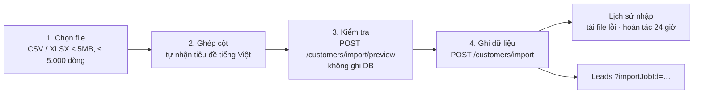

# Tài liệu Kỹ thuật: Nhập Khách hàng từ File (CSV / XLSX)

Chức năng cho phép nhập danh sách thí sinh (ngày hội tư vấn, Google Form, Excel của hệ thống cũ) vào CRM với kiểm tra dữ liệu, chống trùng, lịch sử và hoàn tác.

> **Thay thế chức năng cũ:** trang `/import` và API `/messages/import/*` (nhập *tin nhắn* từ CSV / bảng tính / Google Sheet) đã bị **gỡ bỏ**. Lý do: tin nhắn nhập tay không gắn với kênh thật nên không trả lời được, tạo hội thoại / khách hàng rác và làm lệch số liệu. Link cũ `/import` tự chuyển sang `/leads/import`. Enum kênh `MANUAL_IMPORT` vẫn giữ vì DB còn dữ liệu cũ; webhook tiếp tục từ chối kênh này.

---

## 1. Luồng nghiệp vụ



1. **Chọn file** — đọc ngay trên trình duyệt, không tải file thô lên máy chủ.
   - CSV: UTF-8 (có / không BOM), tự nhận dấu phân cách `,` `;` hoặc tab, hỗ trợ ngoặc kép và xuống dòng trong ô.
   - XLSX: sheet đầu tiên, đọc bằng `DecompressionStream` có sẵn của trình duyệt (không thêm thư viện). `.xls` cũ không hỗ trợ.
2. **Ghép cột** — tự ghép tiêu đề có / không dấu (`Họ và tên`, `SĐT`, `E-mail`, `Trường THPT`, `Ngành quan tâm`…). Có thể ghép nhiều cột vào `Ghi chú` / `Tag`. Chọn giá trị mặc định (giai đoạn, trạng thái, nguồn) và cách xử lý khách trùng.
3. **Kiểm tra (dry-run)** — mỗi dòng nhận kết quả `CREATE` / `UPDATE` / `SKIP` / `ERROR` kèm lý do; tải được file các dòng lỗi.
4. **Ghi** — chạy trong một transaction; tạo mới theo lô 500 dòng.

---

## 2. Trường dữ liệu & quy tắc

| Trường | Bắt buộc | Quy tắc |
| :--- | :--- | :--- |
| Họ và tên | ✔ | Gộp khoảng trắng, ≤ 255 ký tự |
| Số điện thoại / Email | ít nhất một | SĐT chuẩn hóa theo chuẩn Việt Nam (`standardizeVietnamesePhoneNumber`); email chuyển chữ thường |
| Ngày sinh | | `dd/mm/yyyy`, `dd-mm-yyyy`, `dd.mm.yyyy`, `yyyy-mm-dd`, số ngày kiểu Excel; từ chối ngày không tồn tại / tương lai |
| Trường, Địa chỉ, CCCD, Ghi chú | | Cắt theo độ dài cột |
| Ngành / khóa quan tâm | | Nhiều giá trị cách nhau bởi `,` `;` `\|`; đối chiếu tên / mã / id trong danh mục ngành của workspace |
| Giai đoạn | | Đối chiếu id / tên giai đoạn trong pipeline (không phân biệt dấu) |
| Trạng thái | | `NEW/POTENTIAL/QUALIFIED/CONVERTED/UNQUALIFIED` hoặc nhãn tiếng Việt (`Mới`, `Tiềm năng`, `Đã chuyển đổi`, `Chưa phù hợp`…) |
| Nguồn | | Cột trong file, nếu trống dùng nguồn mặc định |
| Tag | | Gộp, bỏ trùng |
| Email người phụ trách | | Phải là chủ hoặc thành viên ACTIVE của workspace |

**Chống trùng:**
- Trong file: dòng sau trùng SĐT / email với dòng trước → `ERROR`.
- Với DB (trong workspace, khách chưa bị gộp): khớp theo `phoneNormalized` hoặc email.

**Xử lý khách đã có** (`duplicateStrategy`):

| Chiến lược | Hành vi |
| :--- | :--- |
| `SKIP` | Không thay đổi |
| `FILL_EMPTY` | Chỉ điền trường đang trống; gộp thêm tag và ngành; ghi chú được nối thêm |
| `OVERWRITE` | Ghi đè bằng giá trị trong file (trường trống trong file không xóa dữ liệu cũ) |

Giá trị **mặc định** (giai đoạn, trạng thái) chỉ áp cho khách mới, không đè lên khách cũ.

**Phân quyền:**
- OWNER: nhập cho cả workspace, chọn người phụ trách theo cột email.
- STAFF: khách nhập vào luôn thuộc về chính họ; không cập nhật khách do người khác phụ trách (`SKIP`); chỉ thấy / hoàn tác lô của mình.

---

## 3. Mô hình dữ liệu (migration `20261113150000_add_customer_import_jobs`)

- Bảng `customer_import_jobs`: tên file, người thực hiện, chiến lược trùng, nguồn, số dòng tổng / tạo / cập nhật / bỏ qua / lỗi, `errors` (JSONB, tối đa 1.000 dòng lỗi để tải lại), `status` (`COMPLETED` / `UNDONE`), `undone_at`, `undone_count`.
- Bảng `customers` thêm:
  - `source VARCHAR(150)` — nguồn khách hàng.
  - `import_job_id UUID` (FK `ON DELETE SET NULL`, index `(workspace_id, import_job_id)`) — chỉ gắn cho khách **được tạo mới** bởi lô.

---

## 4. Hoàn tác

- Trong **24 giờ** kể từ lúc nhập.
- Chỉ xóa khách do lô đó **tạo mới** và **chưa phát sinh** hội thoại, deal hoặc hoạt động; số khách được giữ lại được báo về.
- Các thay đổi lên khách có sẵn (`UPDATE`) **không** được hoàn tác.

---

## 5. API

| Method & đường dẫn | Mô tả |
| :--- | :--- |
| `POST /api/customers/import/preview` | Kiểm tra, trả `summary` + kết quả từng dòng, không ghi DB |
| `POST /api/customers/import` | Ghi dữ liệu, trả `job` + `summary` + kết quả từng dòng |
| `GET /api/customers/import/jobs` | 30 lô gần nhất (STAFF chỉ thấy lô của mình) |
| `GET /api/customers/import/jobs/:id/issues` | Danh sách dòng lỗi / bỏ qua đã lưu |
| `POST /api/customers/import/jobs/:id/undo` | Hoàn tác |
| `GET /api/customers?importJobId=…&source=…` | Lọc danh sách khách theo lô / nguồn |

Body của `preview` / `import` (Zod `CustomerImportRequestSchema`, `apps/api/src/contracts/customer-import.ts`):

```json
{
  "fileName": "ngay-hoi-2026.xlsx",
  "duplicateStrategy": "FILL_EMPTY",
  "defaults": { "leadStage": "STAGE_NEW", "leadStatus": "NEW", "source": "Ngày hội tư vấn 2026" },
  "rows": [
    { "fullName": "Nguyễn Văn An", "phone": "0912345678", "dateOfBirth": "05/09/2008", "interestCourses": "CNTT; Kế toán" }
  ]
}
```

---

## 6. Giao diện

| Vị trí | Nội dung |
| :--- | :--- |
| Leads → nút **Nhập từ file** | Trang `/leads/import` (`apps/web/src/modules/leads/import/CustomerImportPage.tsx`) |
| Trang import, cột phải | Lịch sử nhập: xem khách, tải file lỗi, hoàn tác |
| Leads `?importJobId=` | Banner "Đang xem khách hàng của một lần nhập file", cột Nguồn hiển thị "Nhập file · <nguồn>" |

File lỗi tải về là CSV UTF-8 có BOM, chặn công thức Excel (`=`, `+`, `-`, `@` được thêm tiền tố `'`), giữ nguyên dữ liệu gốc kèm cột lý do để sửa rồi nhập lại.

Kèm theo: sửa lỗi Leads hiển thị trống khi mở từ "Xem khách mới" (response cũ về sau ghi đè bộ lọc mới) — giờ chỉ áp dụng kết quả của lần tải mới nhất.

---

## 7. Kiểm thử

- `apps/api/src/modules/messaging/application/customer-import.service.spec.ts`: phân loại dòng, lỗi giai đoạn / trạng thái / người phụ trách, SKIP / FILL_EMPTY / OVERWRITE, STAFF, hoàn tác (24 giờ, đã hoàn tác, khác người), đọc ngày.
- `apps/web/src/modules/leads/import/import.test.ts`: CSV (BOM, ngoặc kép, `;`), XLSX dựng bằng ZIP thật, tự ghép cột, chặn CSV injection.
- Thủ công trên dev: nhập file 6 dòng (1 tạo mới, 1 trùng, 4 lỗi đúng lý do), xem trên Leads, hoàn tác.
