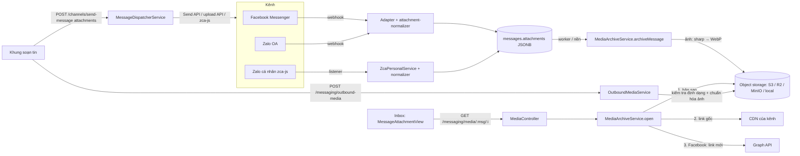
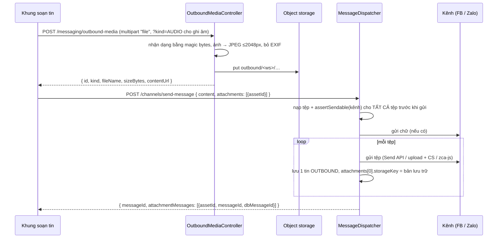

# Tài liệu Kỹ thuật: Media trong Hội thoại (Ảnh, Voice, Video, Sticker, Tệp)

Tài liệu mô tả toàn bộ vòng đời media của Unified Inbox:

1. **Chiều đến** (khách → CRM): chuẩn hóa tệp đính kèm của Facebook, Zalo OA, Zalo cá nhân; lưu bản sao; phát lại; dọn dẹp.
2. **Chiều đi** (CRM → khách): tải tệp lên, gửi ảnh / tài liệu / tin nhắn thoại theo khả năng từng kênh.
3. **Thư viện tài liệu**: tài liệu tuyển sinh dùng lại (brochure, bảng học phí…).

> **Nguyên tắc xuyên suốt:** Postgres **không bao giờ chứa nhị phân**. Cột `messages.attachments` (JSONB) chỉ giữ metadata, URL gốc và `storageKey` trỏ tới object storage. Nhờ vậy DB và bản backup không phình theo lượng ảnh.

---

## 1. Kiến trúc tổng quan



| Thành phần | Tệp | Vai trò |
| :--- | :--- | :--- |
| Chuẩn hóa chiều đến | `apps/api/src/modules/messaging/domain/media/attachment-normalizer.ts` | Đưa mọi định dạng về `NormalizedAttachment`, sinh nội dung tóm tắt (`[Hình ảnh]`, `[Tin nhắn thoại]`…) |
| Chính sách chiều đi | `apps/api/src/modules/messaging/domain/media/outbound-media-policy.ts` | Nhận dạng định dạng bằng nội dung tệp, giới hạn theo kênh |
| Object storage | `apps/api/src/modules/messaging/infrastructure/media-storage/media-storage.ts` | Driver `s3` / `local` / `none` |
| Xử lý ảnh | `apps/api/src/modules/messaging/infrastructure/media-storage/image-optimizer.ts` | WebP cho bản lưu trữ, JPEG cho ảnh gửi đi, ép ≤ 1MB cho Zalo OA |
| Lưu bản sao & phát media | `apps/api/src/modules/messaging/application/media-archive.service.ts` | Archive, `open()`, dọn theo hạn lưu trữ |
| Tệp gửi đi & thư viện | `apps/api/src/modules/messaging/application/outbound-media.service.ts` | Tải lên, nạp để gửi, đánh dấu đã gửi, dọn tệp chờ |
| Gửi theo kênh | `apps/api/src/modules/channel-connection/application/outbound-attachment.sender.ts` | Facebook Send API, Zalo OA upload + CS message |
| Zalo cá nhân | `apps/api/src/modules/channel-connection/application/zca-personal.service.ts` | Nhận media (normalizer), gửi ảnh / tệp / voice qua zca-js |
| Giao diện | `apps/web/src/modules/inbox/components/chat-window/…` | `MessageAttachmentView`, `ChatComposer`, `MediaLibraryModal`, hooks |

---

## 2. Mô hình dữ liệu

### 2.1. `messages.attachments` (JSONB) — `NormalizedAttachment`

```ts
interface NormalizedAttachment {
  id: string;              // "<mã tin của kênh>_<thứ tự>" — ổn định khi webhook gửi lại
  type: 'IMAGE' | 'AUDIO' | 'VIDEO' | 'FILE' | 'STICKER';
  url: string;             // URL gốc trên CDN của kênh (có thể hết hạn); '' với tệp CRM gửi đi
  name?: string;
  size?: string;           // dạng hiển thị: "1.2 MB"
  duration?: string;       // dạng hiển thị: "0:15"
  stickerId?: string | number;
  mimeType?: string;       // định dạng gốc
  thumbnailUrl?: string;
  storageKey?: string;     // khóa object storage khi đã có bản sao
  storedBytes?: number;
  storedMimeType?: string; // định dạng bản sao (VD: image/webp sau khi nén)
  originalBytes?: number;  // dung lượng trước khi nén
  archivedAt?: string;
  expired?: boolean;       // link gốc chết và không còn bản sao
}
```

### 2.2. Bảng `media_assets` (migration `20261113170000_add_media_assets`)

Chỉ dùng cho **tệp do CRM gửi đi** và **thư viện tài liệu**; media chiều đến không có dòng ở đây.

| Cột | Ý nghĩa |
| :--- | :--- |
| `purpose` | `OUTBOUND` (tải lên để gửi trong hội thoại) \| `LIBRARY` (tài liệu dùng lại) |
| `status` | `PENDING` (chờ gửi) \| `ACTIVE` (thư viện) — tệp `OUTBOUND` gửi xong thì **xóa dòng**, tin nhắn giữ `storageKey` |
| `kind`, `mime_type`, `size_bytes`, `width`, `height` | Kết quả nhận dạng / chuẩn hóa thật trên máy chủ |
| `storage_key` (unique) | `outbound/<ws>/<yyyy>/<mm>/<uuid>.<ext>` hoặc `library/<ws>/<yyyy>/<mm>/<uuid>.<ext>` |
| `channel_refs` | Cache theo kênh, hiện dùng `facebookAttachmentId` để gửi lại tài liệu thư viện không cần tải lên |

### 2.3. Quy ước khóa object storage

| Tiền tố | Chủ sở hữu | Bị xóa khi |
| :--- | :--- | :--- |
| `<workspaceId>/<yyyy>/<mm>/<messageId>/<i>.<ext>` | Tin nhắn chiều đến | Hết hạn lưu trữ, purge tin, gỡ kênh |
| `outbound/<workspaceId>/…` | Tin nhắn chiều đi (sau khi gửi) / tệp chờ | Như trên; tệp chờ không gửi bị xóa sau 24 giờ |
| `library/<workspaceId>/…` | Thư viện (dùng chung cho nhiều tin) | **Chỉ** khi chủ workspace xóa khỏi thư viện — mọi cơ chế dọn theo tin nhắn đều bỏ qua tiền tố này |

---

## 3. Chiều đến: chuẩn hóa & lưu bản sao

### 3.1. Chuẩn hóa theo kênh

| Kênh | Nguồn | Xử lý |
| :--- | :--- | :--- |
| Facebook webhook | `message.attachments[]` | `image/audio/video/file`; sticker từ `payload.sticker_id` → `lookaside.facebook.com/stickers/<id>.png`; bỏ `fallback`/`template` |
| Facebook đồng bộ Graph | `attachments.data[]` (`image_data`, `video_data`, `file_url`, `mime_type`) | Đồng bộ xin thêm trường `attachments{…}`; tin **chỉ có ảnh** (không có chữ) vẫn được đồng bộ |
| Zalo OA webhook | `event_name` (`user_send_image/gif/audio/video/sticker/file`) + `message.attachments[]` | Ảnh có `payload.id` **không** bị nhầm là sticker; bỏ `link/location/business_card`; mọi `oa_send_*` là tin chiều đi |
| Zalo cá nhân (zca-js) | `msgType` (`chat.photo`, `chat.voice`, `chat.video.msg`, `chat.sticker`, `share.file`, `chat.gif`) + `content{href, thumb, params}` | Ảnh lấy bản HD trong `params.hd`; voice lấy `duration`; tệp lấy `fileSize`, `fileExt` |
| Dữ liệu cũ | `rawPayload` | `attachmentsFromRawPayload()` tự nhận dạng nguồn; backfill ghi `[]` cho tin không có đính kèm để không quét lặp |

### 3.2. Lưu bản sao (archive)

- Kích hoạt: worker xử lý tin đến (`InboundMessageSideEffects`) và `ZcaPersonalService` sau khi lưu tin — chạy nền, lỗi chỉ ghi log.
- Chính sách mặc định: **chỉ ảnh và voice của Zalo** (link CDN Zalo hết hạn và không có API lấy lại). Facebook không cần vì xin được link mới. Sticker không bao giờ lưu. Video / tệp chỉ giữ link gốc.
- Tải về qua `safeGet` (chặn SSRF tới địa chỉ nội bộ, giới hạn redirect, timeout 15s, giới hạn dung lượng).
- **Ảnh được nén WebP** bằng `sharp` trước khi lưu: xoay theo EXIF, bỏ metadata (GPS, thiết bị), thu nhỏ cạnh dài ≤ 1600px, chất lượng 80, GIF động giữ chuyển động. Nếu WebP không nhỏ hơn bản gốc thì giữ bản gốc. Đo trên ảnh thật: giảm 52–71% (ảnh đã nén sẵn có thể chỉ ~1%).

### 3.3. Phát media: `GET /api/messaging/media/:messageRef/:index`

`messageRef` là UUID trong DB **hoặc** mã tin của kênh (tin realtime chưa có UUID). Chỉ phát tin thuộc workspace của phiên đăng nhập.

Thứ tự nguồn:
1. **Bản sao** trong object storage (`X-Media-Source: storage`, cache 1 ngày).
2. **Link gốc** của kênh (`origin`).
3. **Facebook**: gọi `GET /{message-id}?fields=attachments` để lấy link mới, cập nhật lại `url` (`refreshed`).
4. Không còn nguồn → `410 MEDIA_EXPIRED`, đánh dấu `expired: true`.

Header an toàn: chỉ ảnh / audio / video / PDF được `inline`, còn lại ép tải về; `X-Content-Type-Options: nosniff`, `Content-Security-Policy: default-src 'none'; sandbox`.

### 3.4. Hiển thị trong Inbox (`MessageAttachmentView.tsx`)

- Có `storageKey` → tải thẳng qua endpoint (blob URL, vì `` không gửi được header xác thực).
- Không có → thử link CDN gốc trước (không tốn băng thông máy chủ), lỗi thì chuyển sang endpoint.
- Ảnh / sticker có lightbox; **voice có trình phát `<audio>`**, **video có `<video>`**; tệp tải về qua endpoint.
- Nhãn tóm tắt do hệ thống sinh (`[Hình ảnh]`, `[Tệp: …]`…) không lặp lại thành chữ trong bong bóng.

### 3.5. Dọn dẹp

| Cơ chế | Lịch | Hành vi |
| :--- | :--- | :--- |
| `MediaArchiveService.cleanupExpired` | Cron 03:00 hằng ngày | Xóa bản sao cũ hơn `MEDIA_RETENTION_DAYS`, giữ metadata, đánh dấu `expired`; bỏ qua `library/` |
| Purge tin (`MessageStorageRepository`) | Theo chính sách lưu trữ tin | Xóa bản sao **trước** khi xóa tin |
| Gỡ kênh (`ChannelManagerService`) | Khi xóa tài khoản kênh | Xóa bản sao của mọi tin thuộc kênh |
| `OutboundMediaService.cleanupPending` | Phút 15 mỗi giờ | Xóa tệp tải lên mà không gửi sau 24 giờ |

---

## 4. Chiều đi: gửi ảnh, tài liệu, tin nhắn thoại

### 4.1. Luồng



- Mỗi tệp là **một tin riêng** trên kênh và trong DB; giao diện thay tin tạm bằng đúng các tin đó (cùng id với sự kiện realtime) nên không hiện trùng.
- Kiểm tra khả năng kênh diễn ra **trước** khi gửi bất kỳ phần nào: nếu một tệp không hợp lệ thì không gửi cả phần chữ.
- Webhook echo đến trước khi API trả về: dispatcher gộp `storageKey` vào tin echo (`attachToEchoedMessage`).
- Gửi lỗi: tin tạm bị gỡ, khung soạn **giữ lại** tệp để thử lại.

### 4.2. Khả năng theo kênh

| | Facebook Messenger | Zalo OA | Zalo cá nhân |
| :--- | :--- | :--- | :--- |
| Ảnh | ✔ multipart `filedata`, ≤ 8MB sau chuẩn hóa | ✔ `upload/image` (jpg/png **≤ 1MB**, CRM tự nén) → template `media` | ✔ `sendMessage({ attachments: [{ data: Buffer }] })` |
| GIF | ✔ | ✔ `upload/gif` ≤ 5MB | ✔ |
| Tài liệu | ✔ ≤ 25MB | ✔ `upload/file` — chỉ PDF / DOC / DOCX ≤ 5MB | ✔ ≤ 25MB |
| Voice | ✔ `audio` | ✘ API không hỗ trợ | ✔ `uploadAttachment` → `sendVoice` |
| Video | ✔ mp4 / mov / webm ≤ 25MB | ✘ | ✔ gửi dạng tệp (mp4 / mov) |
| Giới hạn hội thoại | 24 giờ kể từ tin cuối của khách | Khách tương tác trong 7 ngày (`-201`) | Chống khóa tài khoản: giãn cách gửi sẵn có |
| Dùng lại tệp | `attachment_id` (`is_reusable`) lưu trong `channel_refs` cho tài liệu thư viện | Tải lên mỗi lần | Tải lên mỗi lần |

Giới hạn dung lượng ghi theo tài liệu của nền tảng tại thời điểm viết; nếu nền tảng đổi, chỉnh `OUTBOUND_RULES` (API) và `CHANNEL_CAPS` (web) cho khớp.

### 4.3. Bảo mật khi tải lên

- Định dạng xác định bằng **chữ ký đầu tệp** (magic bytes), không tin đuôi tệp hay `Content-Type` của trình duyệt.
- Chặn HTML, SVG, script, tệp thực thi (kể cả khi đổi đuôi thành `.png` / `.txt`).
- Tên tệp được làm sạch và luôn mang đuôi đúng định dạng thật.
- Ảnh luôn được giải mã và mã hóa lại (loại payload ẩn, bỏ EXIF / GPS).
- Giới hạn 25MB / tệp ở plugin multipart và service; tối đa 10 tệp / tin.
- Tệp và thư viện cô lập theo workspace của phiên đăng nhập; `send-message` ưu tiên workspace đã xác minh thay vì header client.
- Endpoint chung chịu rate limit 150 request / phút / IP.

### 4.4. Giao diện khung soạn tin

| Thao tác | Hành vi |
| :--- | :--- |
| 📎 / 🖼 | Chọn nhiều tệp; `accept` theo kênh của hội thoại |
| Kéo thả vào khung soạn | Hiện lớp phủ "Thả tệp để đính kèm…" |
| Ctrl+V trong ô nhập | Dán ảnh chụp màn hình |
| 📁 Thư viện | Chọn tài liệu có sẵn (không cần tải lên lại) |
| 🎤 | Ghi âm bằng `MediaRecorder` (ưu tiên AAC/MP4, không có thì Opus/WebM), tối đa 120 giây; chỉ hiện ở Facebook và Zalo cá nhân |
| Chip tệp chờ | Ảnh xem trước, tiến trình tải lên (XHR), lỗi theo từng tệp, nút bỏ (xóa luôn trên máy chủ) |
| Nút Gửi | Khóa khi đang tải lên / có tệp lỗi / quá 24 giờ Facebook |
| Đổi hội thoại | Tệp chưa gửi của hội thoại cũ bị bỏ |

Kiểm tra phía giao diện (`outboundMediaRules.ts`) chỉ để báo lỗi sớm; máy chủ luôn kiểm tra lại.

---

## 5. Thư viện tài liệu

- Mở từ nút 📁 trong khung soạn tin (`MediaLibraryModal`).
- **Mọi thành viên** xem và chọn tài liệu để gửi; **chủ workspace** thêm (kèm tên hiển thị), đổi tên, xóa.
- Tài liệu không hợp lệ với kênh hiện tại được đánh dấu và không chọn được (VD: tệp `.xlsx` với Zalo OA).
- Gửi tài liệu thư viện **không** chuyển quyền sở hữu: tin nhắn chỉ tham chiếu `library/…`, dọn dẹp theo tin không xóa tệp gốc. Xóa tài liệu khỏi thư viện thì các tin cũ hiển thị "không còn tải được".

---

## 6. API

| Method & đường dẫn | Quyền | Mô tả |
| :--- | :--- | :--- |
| `GET /api/messaging/media/:messageRef/:index` | Thành viên workspace | Phát media của tin (bản sao → link gốc → link mới) |
| `POST /api/messaging/outbound-media?kind=AUDIO` | Thành viên | Multipart `file`; trả `MediaAsset` chờ gửi |
| `DELETE /api/messaging/outbound-media/:id` | Người tải lên / chủ workspace | Bỏ tệp chưa gửi |
| `GET /api/messaging/assets/:id/content` | Thành viên | Xem trước tệp chờ gửi / tài liệu thư viện |
| `GET /api/messaging/media-library?search=` | Thành viên | Danh sách thư viện |
| `POST /api/messaging/media-library?title=` | Chủ workspace | Multipart `file` |
| `PATCH /api/messaging/media-library/:id` | Chủ workspace | `{ "title": "…" }` |
| `DELETE /api/messaging/media-library/:id` | Chủ workspace | Xóa tài liệu và tệp |
| `POST /api/channels/send-message` | Thành viên (STAFF chỉ hội thoại được giao) | Thêm `attachments: [{ assetId }]`; `content` có thể rỗng khi có tệp |

Ví dụ gửi kèm tệp:

```bash
curl -X POST http://localhost:3000/api/messaging/outbound-media \
  -H "Authorization: Bearer <token>" -H "x-workspace-id: <ws>" \
  -F "file=@brochure.pdf"
# → { "id": "a1b2…", "kind": "FILE", "fileName": "brochure.pdf", … }

curl -X POST http://localhost:3000/api/channels/send-message \
  -H "Authorization: Bearer <token>" -H "Content-Type: application/json" \
  -d '{"channel":"FACEBOOK","recipientId":"<psid>","conversationId":"<uuid>","content":"Gửi bạn brochure","attachments":[{"assetId":"a1b2…"}]}'
```

---

## 7. Cấu hình

| Biến môi trường | Mặc định | Ý nghĩa |
| :--- | :--- | :--- |
| `MEDIA_STORAGE_DRIVER` | `local` (dev) / `none` (production) | `s3` \| `local` \| `none`. Với `none`, chức năng gửi tệp và thư viện báo lỗi rõ ràng |
| `MEDIA_S3_ENDPOINT`, `MEDIA_S3_BUCKET`, `MEDIA_S3_ACCESS_KEY_ID`, `MEDIA_S3_SECRET_ACCESS_KEY` | — | Bắt buộc khi `s3` (R2, MinIO, AWS S3, Backblaze B2) |
| `MEDIA_S3_REGION` | `auto` | R2 dùng `auto`, AWS dùng vùng thật |
| `MEDIA_S3_FORCE_PATH_STYLE` | `true` | `false` để dùng virtual-hosted style |
| `MEDIA_STORAGE_DIR` | `storage/media` | Thư mục khi `local` (đã có trong `.gitignore`) |
| `MEDIA_ARCHIVE_CHANNELS` | `ZALO` | Kênh lưu bản sao chiều đến |
| `MEDIA_ARCHIVE_TYPES` | `IMAGE,AUDIO` | Loại lưu bản sao chiều đến |
| `MEDIA_ARCHIVE_MAX_BYTES` | `10485760` | Giới hạn mỗi tệp lưu bản sao |
| `MEDIA_IMAGE_WEBP` | `true` | Nén WebP bản sao ảnh chiều đến |
| `MEDIA_IMAGE_MAX_DIMENSION` | `1600` | Cạnh dài tối đa ảnh lưu trữ |
| `MEDIA_IMAGE_WEBP_QUALITY` | `80` | Chất lượng WebP |
| `MEDIA_RETENTION_DAYS` | `365` | Hạn giữ bản sao |
| `MEDIA_PROXY_MAX_BYTES` | `26214400` | Giới hạn mỗi tệp phát qua API |
| `MEDIA_PROXY_ALLOWED_HOSTS` | (mọi host công khai) | Danh sách hậu tố host được tải media |

**Ước tính chi phí lưu trữ:** 1.000 ảnh / ngày × ~50KB (sau WebP) ≈ 1,5GB / tháng. Với Cloudflare R2 (~0,015 USD / GB / tháng, không tính băng thông tải xuống) chi phí không đáng kể; quan trọng hơn là DB không phình.

### Phụ thuộc

- `sharp@0.35.5` (xử lý ảnh, libvips có WebP / mozjpeg) và `@fastify/multipart@10.1.6` — cài bằng `npx pnpm@12.18.0 --filter api add …` (khớp phiên bản pnpm đã tạo `node_modules`).
- `sharp` dùng binary dựng sẵn theo nền tảng: build Docker / Linux phải chạy `pnpm install` trên chính nền tảng đó. Thiếu binary thì CRM vẫn chạy, chỉ bỏ qua bước nén (ghi cảnh báo).
- Không dùng AWS SDK: driver S3 tự ký SigV4.

---

## 8. Kiểm thử

| Tệp test | Nội dung |
| :--- | :--- |
| `domain/media/attachment-normalizer.spec.ts` | Chuẩn hóa FB / Zalo OA / zca-js / Graph, id ổn định, tóm tắt |
| `domain/media/outbound-media-policy.spec.ts` | Magic bytes (13 định dạng), chặn SVG/HTML/EXE đổi đuôi, giới hạn kênh, tên tệp an toàn |
| `infrastructure/media-storage/media-storage.spec.ts` | Driver local, chặn path traversal, ký SigV4, cấu hình từ env |
| `infrastructure/media-storage/image-optimizer.spec.ts` | WebP + thu nhỏ, không phóng to, giữ bản gốc khi WebP lớn hơn |
| `application/media-archive.service.spec.ts` | Archive đúng chính sách, nén WebP thật, phát từ bản sao, xin link Facebook mới, hết hạn, dọn dẹp |
| `application/outbound-media.service.spec.ts` | Chuẩn hóa ảnh (bỏ EXIF, 2048px), chặn tệp nguy hiểm, quyền thư viện, ghi âm WebM, thứ tự gửi, dọn tệp chờ |
| `channel-connection/application/outbound-attachment.sender.spec.ts` | FB multipart + dùng lại `attachment_id`, lỗi 24h; Zalo OA ảnh / PDF / nén ≤ 1MB / lỗi 7 ngày |
| `test/channel-connection/dispatcher-attachments.spec.ts` | Chữ + tệp thành nhiều tin, chỉ tệp, kiểm tra kênh trước khi gửi, tin trống |

Kiểm thử thủ công đã làm trên môi trường dev: thêm / chọn / xóa tài liệu thư viện, tải ảnh lên (PNG → JPEG), bỏ tệp chờ (dòng `media_assets` và tệp được xóa), phát ảnh Facebook thật qua endpoint, lưu bản sao ảnh vào storage local.

**Chưa kiểm thử với kênh thật:** gửi tệp tới khách thật (Facebook / Zalo OA / Zalo cá nhân) và ghi âm bằng micro. Nên thử với tài khoản test trước khi đưa vào sử dụng.

---

## 9. Hạn chế đã biết

- Zalo OA không có API gửi voice / video; tài liệu chỉ PDF / DOC / DOCX.
- Ghi âm WebM/Opus (Chrome, Firefox) — Messenger thường phát được nhưng chưa xác minh trên mọi thiết bị; Safari ghi AAC/MP4.
- Video không được nén / chuyển mã (cần ffmpeg).
- Tin Facebook cũ được lưu trước khi đồng bộ xin trường `attachments` không có dữ liệu tệp để khôi phục.
- Kiểm tra virus (ClamAV) chưa có; hiện dựa vào danh sách định dạng cho phép + mã hóa lại ảnh.
