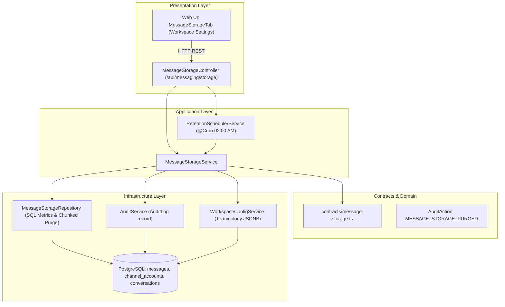

# Tài liệu Kỹ thuật: Quản lý Dung lượng & Tự động Dọn dẹp Tin nhắn (Message Storage & Retention)

Tài liệu này mô tả chi tiết giải pháp đo lường dung lượng lưu trữ tin nhắn, cơ chế dọn dẹp tin nhắn quá hạn an toàn, tự động dọn dẹp tin nhắn cũ sau 12 tháng và chiến lược chống phình cơ sở dữ liệu PostgreSQL trong hệ thống **CUSC Recruitment CRM**.

---

## 1. Tổng quan Kiến trúc

Hệ thống được thiết kế theo nguyên tắc **Hexagonal / Clean Architecture**:



---

## 2. Đo lường Mức dung lượng (Storage Metrics Engine)

### 2.1. Phân tầng Dung lượng trong PostgreSQL
Bảng `messages` bao gồm các trường:
- `content` (`Text`): Văn bản tin nhắn trao đổi.
- `attachments` (`JsonB`): Siêu dữ liệu tệp, hình ảnh.
- `raw_payload` (`JsonB`): Toàn bộ webhook gốc từ Zalo, Facebook, TikTok. Đây là trường chiếm tới **70–85% dung lượng lưu trữ** và được PostgreSQL đưa vào lưu trữ riêng biệt ở bảng **TOAST**.

### 2.2. Đo lường Vật lý & Logic
1. **Dung lượng Vật lý (Physical Table Sizes)**:
   - `pg_total_relation_size('messages')`: Tổng dung lượng bảng + index + TOAST.
   - `pg_relation_size('messages')`: Dung lượng bảng dữ liệu chính (Main fork).
   - `pg_indexes_size('messages')`: Dung lượng các chỉ mục index (`channel_account_id`, `external_message_id`, `sent_at`...).
   - `toast_bytes`: Phần chênh lệch giữa tổng dung lượng và bảng chính + index (nơi chứa `raw_payload`).
2. **Dung lượng Logic theo Kênh & Độ tuổi**:
   - `SUM(pg_column_size(content) + pg_column_size(raw_payload) + pg_column_size(attachments))`
   - Phân loại độ tuổi:
     - Dưới 30 ngày (Hot Data)
     - 1 – 6 tháng (Warm Data)
     - 6 – 12 tháng (Cold Data)
     - Trên 12 tháng (Expired Data - Sẵn sàng dọn dẹp)

---

## 3. Cơ chế Dọn dẹp & Chống phình Database (PostgreSQL Bloat Mitigation)

### 3.1. Vấn đề cốt lõi của PostgreSQL MVCC
Khi thực hiện lệnh `DELETE` trong PostgreSQL:
- Bản ghi **không bị xóa vật lý ngay trên ổ đĩa**, mà chỉ được đánh dấu là *Dead Tuple*.
- Dung lượng trên đĩa OS **không giảm xuống ngay**.
- Nếu xóa hàng triệu bản ghi cùng lúc bằng lệnh đơn lẻ:
  - Gây lock bảng kéo dài, làm nghẽn luồng tiếp nhận tin nhắn realtime của Webhook.
  - Gây tràn transaction log (WAL - Write-Ahead Logging).
  - Gây hiện tượng phân mảnh (Table Bloat) nghiêm trọng nếu Autovacuum không theo kịp.

### 3.2. Thuật toán Xóa theo Lô (Chunked Batch Deletion)
Thay vì thực hiện một lệnh `DELETE` khổng lồ, `MessageStorageRepository` áp dụng thuật toán chia nhỏ:
1. Tìm kiếm mẻ tin nhắn mục tiêu (Batch size: **1,000 bản ghi/lần**).
2. Xóa hoặc cập nhật (`DELETE` hoặc `UPDATE raw_payload = '{}'`) mẻ 1,000 bản ghi.
3. Nghỉ giải lao **50ms** giữa các batch để nhường I/O và khóa khóa (locks) cho các giao dịch chat realtime của người dùng.
4. Lặp lại cho đến khi hết dữ liệu hết hạn.

### 3.3. Chế độ Tinh gọn Dữ liệu (Slim Payload Only - Khuyên dùng)
Hệ thống hỗ trợ 2 chế độ:
- **Chế độ 1: Slim Payload Only**:
  - Thực hiện: `UPDATE messages SET raw_payload = '{}'::jsonb WHERE sent_at < [cutoff] AND raw_payload::text != '{}'`
  - **Lợi ích**: Giải phóng ngay **70–80% dung lượng** mà vẫn giữ nguyên 100% lịch sử trao đổi phục vụ tư vấn học viên/khách hàng.
- **Chế độ 2: Hard Delete**:
  - Xóa hoàn toàn bản ghi tin nhắn và các hội thoại mồ côi (`RESOLVED` và 0 tin nhắn).

### 3.4. Cấu hình Autovacuum tối ưu cho bảng Messages
Thực thi trên PostgreSQL để giúp Autovacuum thu gom dead tuples thường xuyên hơn:
```sql
ALTER TABLE messages SET (
    autovacuum_vacuum_scale_factor = 0.05,
    autovacuum_vacuum_cost_limit = 1000
);
```

### 3.5. Chiến lược Phân vùng Bảng theo Tháng (Table Partitioning)
Đối với hệ thống có quy mô hàng chục triệu tin nhắn mỗi năm, khuyến nghị phân vùng bảng `messages` theo tháng (`RANGE (sent_at)`):
```sql
CREATE TABLE messages_y2025m11 PARTITION OF messages
    FOR VALUES FROM ('2025-11-01') TO ('2025-12-01');
```
Khi tin nhắn đã cũ hơn 12 tháng:
```sql
DROP TABLE messages_y2024m11;
```
- **Ưu điểm**: Lệnh hoàn tất trong **vài mili-giây**, giải phóng **100% dung lượng đĩa vật lý ngay lập tức trên hệ điều hành**, hoàn toàn không tạo Dead Tuples hay Table Bloat!

---

## 4. Tự động Dọn dẹp Định kỳ (Automated 12-Month Retention Scheduler)

- **Cron Expression**: `0 2 * * *` (Chạy vào 02:00 AM hàng ngày, giờ thấp điểm tại Việt Nam).
- **Quy tắc**:
  1. Quét toàn bộ các workspace đang kích hoạt.
  2. Kiểm tra cấu hình `retentionPolicy` của từng workspace (mặc định: `retentionMonths = 12`, `autoCleanupEnabled = true`).
  3. Xử lý dọn dẹp theo batch an toàn.
  4. Ghi nhận `AuditAction.MESSAGE_STORAGE_PURGED` với siêu dữ liệu chi tiết (số tin đã dọn, dung lượng giải phóng, thời gian chạy).

---

## 5. Danh mục REST API

| Phương thức | Đường dẫn API | Quyền hạn | Mô tả |
| :--- | :--- | :--- | :--- |
| `GET` | `/api/messaging/storage/metrics` | User/Staff | Lấy toàn bộ số liệu đo lường dung lượng, phân loại theo kênh và độ tuổi. |
| `GET` | `/api/messaging/storage/policy` | User/Staff | Lấy chính sách lưu trữ của workspace. |
| `PATCH` | `/api/messaging/storage/policy` | OWNER/ADMIN | Cập nhật chính sách lưu trữ (thời hạn tháng, bật/tắt tự động). |
| `POST` | `/api/messaging/storage/estimate-purge` | User/Staff | **Dry Run API**: Tính toán trước số lượng và dung lượng sẽ giải phóng. |
| `POST` | `/api/messaging/storage/purge` | OWNER/ADMIN | Kích hoạt dọn dẹp thủ công theo bộ lọc và chế độ đã chọn. |
| `POST` | `/api/messaging/storage/retention/trigger-now` | OWNER/ADMIN | Kích hoạt chạy ngay quy trình tự động dọn dẹp định kỳ 12 tháng. |

---

## 6. Giao diện Người dùng (Web UI)

Tích hợp tại **Cài đặt Không gian làm việc (Workspace Settings)** -> Tab **Lưu trữ & Dọn dẹp tin nhắn**:
1. **Cards Thống kê**: Tổng dung lượng, tổng số tin, tin nhắn quá hạn > 12 tháng, trạng thái tự động dọn dẹp.
2. **Biểu đồ Phân bổ**:
   - Phân bổ theo Kênh (Zalo, Facebook, TikTok, Nhập tay) kèm % dung lượng.
   - Phân bổ theo Độ tuổi (< 30 ngày, 1-6 tháng, 6-12 tháng, > 12 tháng).
3. **Form Chính sách**:
   - Bật/tắt tự động dọn dẹp hàng ngày.
   - Chọn thời hạn lưu trữ (3, 6, 12, 24 tháng).
   - Tùy chọn chỉ dọn dẹp Raw Payload.
4. **Modal Dọn dẹp thủ công với Dry-Run Preview**:
   - Xem trước chính xác số tin nhắn và dung lượng sẽ được giải phóng trước khi xác nhận.
   - Cơ chế bảo mật an toàn (yêu cầu gõ "XOA" khi chọn xóa vĩnh viễn tin nhắn).
5. Cơ chế kiểm soát hiện tại
Giới hạn thời gian lưu trữ mặc định: 12 tháng (tự động dọn dẹp các tin nhắn có sentAt > 12 tháng vào lúc 02:00 AM hàng ngày).
Mức dung lượng thực tế: Không giới hạn cứng dung lượng tối đa (GB), hệ thống đo lường và hiển thị trực tiếp dung lượng thực tế sử dụng từ PostgreSQL (pg_total_relation_size).
Đặc thù dữ liệu tin nhắn trong CRM:
Văn bản tin nhắn (content): Rất nhẹ, trung bình chỉ khoảng 150 – 300 bytes / tin (1 triệu tin nhắn văn bản chỉ chiếm ~200 – 300 MB).
Dữ liệu webhook thô (raw_payload): Chiếm khoảng 1 – 2.5 KB / tin (1 triệu tin chiếm ~1.5 – 2.5 GB).
Tệp / Ảnh đính kèm (attachments): Hệ thống lưu dạng đường dẫn URL / CDN metadata trong JSONB chứ không lưu file nhị phân trực tiếp trong bảng tin nhắn.